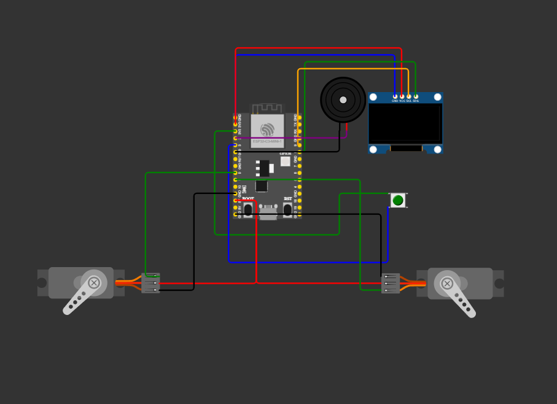

# 🧩 cube_friend — Живой Робот-Компаньон

<p align="center">
  
  
  
  
</p>

---

**cube_friend** — это открытый проект милого интерактивного робота-гаджета на базе микроконтроллера **ESP32-C3**. Робот имитирует «живое» существо: он дышит, моргает, оглядывается по сторонам, меняет выражения глаз в зависимости от настроения, двигает ручками-сервами и бурно радуется при нажатии на кнопку.

> ✨ *Благодаря плавной интерполяции, анимации лица (глаз) перетекают друг в друга без резких рывков.*

---

## 🚀 Функциональные возможности

### 🧠 Особенности поведения
*   **Живая мимика:** Изменения геометрии и формы глаз полностью сглажены во времени через экспоненциальное приближение.
*   **Имитация дыхания:** В состоянии покоя глаза робота плавно покачиваются вверх-вниз (`Vertical Bobbing`), создавая эффект дыхания. При радости покачивание превращается в задорный прыгающий такт.
*   **Случайные саккады:** Робот периодически осматривается по сторонам, задерживая взгляд или быстро переключая его. При взгляде в стороны учитывается эффект перспективы (ближний глаз слегка сжимается).
*   **Реалистичное моргание:** Одиночные и редкие двойные моргания с быстрой фазой закрытия и плавным открытием глаз.

### 🎭 Генератор эмоций и микро-действий
В режиме ожидания (`M_IDLE`) робот случайным образом воспроизводит различные состояния:
*   🟢 `P_NORMAL` — Обычное спокойное состояние.
*   🟡 `P_SQUINT` — Робот подозрительно прищуривается.
*   🔵 `P_CURIOUS` — Любопытство (один глаз становится больше, взгляд косится вверх).
*   💤 `P_SLEEPY` — Сонный взгляд (веки опускаются, моргание становится ленивым).
*   😳 `P_WIDE` — Удивленные, широко распахнутые глаза.
*   🎯 `P_FOCUSED` — Сосредоточенный, целеустремленный взгляд.

### ❤️ Режим Радости (`M_HAPPY`)
При клике на тактовую кнопку робот мгновенно преображается:
*   Глаза превращаются в счастливые дуги `^ ^`.
*   Сервоприводы синхронно поднимают ручки вверх (`ARM_UP_ANGLE = 135°`).
*   Встроенный зуммер проигрывает позитивную двухтональную мелодию.
*   Вокруг глаз на OLED-дисплее начинают летать и пульсировать 4 маленьких анимированных сердечка.

---

## 🔌 Схема подключения (Пинмап)

Ниже представлена визуальная схема сборки устройства. Вы можете собрать проект по этому образцу:



Прошивка настроена под дефолтные пины платы **ESP32-C3 Super Mini**.

| Компонент | Вывод компонента | Пин ESP32-C3 | Описание в коде |
| :--- | :--- | :--- | :--- |
| **OLED Дисплей** | SCL | **GPIO 9** | `clock` (HW I2C) |
| (SSD1306 128x64) | SDA | **GPIO 8** | `data` (HW I2C) |
| **Кнопка (Button)** | Signal | **GPIO 3** | `BUTTON_PIN` (Стянут к GND) |
| **Зуммер (Buzzer)** | Signal | **GPIO 2** | `BUZZER_PIN` (Пьезо-пищалка) |
| **Левая Серва** | PWM | **GPIO 0** | `LEFT_ARM_PIN` (Управление рукой) |
| **Правая Серва** | PWM | **GPIO 1** | `RIGHT_ARM_PIN` (Работает инверсивно) |

*Питание сервоприводов и дисплея рекомендуется осуществлять от линий 5V/GND контроллера (или внешнего источника, если сервоприводы мощные).*

---

## 📂 Структура репозитория

```text
├── .vscode/             # Конфигурация сред разработки VS Code
├── include/             # Заголовочные файлы проекта
├── lib/                 # Локальные библиотеки
├── src/
│   └── main.cpp         # Основная логика: стейт-машина, физика серво и рендеринг глаз
├── test/                # Модульные тесты
├── diagram.json         # Схема цепей для эмуляции в Wokwi
├── platformio.ini       # Конфиг PlatformIO (зависимость: U8g2)
└── wokwi.toml           # Настройки моста для симулятора Wokwi
```

---

## 🛠️ Сборка и развертывание

### Локальная компиляция

1. Установите [VS Code](https://visualstudio.com) и расширение **PlatformIO IDE**.
2. Склонируйте проект на ПК:
   ```bash
   git clone https://github.com
   cd cube_friend
   ```
3. Откройте директорию в VS Code. Менеджер зависимостей PlatformIO автоматически скачает библиотеку `olikraus/U8g2`.
4. Нажмите **Build** (галочка снизу) для проверки сборки.
5. Подключите ESP32-C3 через USB и нажмите **Upload** (стрелочка) для прошивки.

### Работа в симуляторе Wokwi

Для запуска интерактивной симуляции прямо в редакторе:
1. Установите плагин **Wokwi** для VS Code.
2. Нажмите `F1` или `Ctrl+Shift+P`, введите и выберите `Wokwi: Start Simulator`.
3. Нажимайте на зеленую виртуальную кнопку на схеме, чтобы активировать анимацию радости с сердечками и взмахами рук!

---

## ⚙️ Тюнинг и кастомизация углов

Вы можете легко изменить амплитуду движения рук робота в верхних строках `src/main.cpp`:
```cpp
static const float ARM_DOWN_ANGLE = 45.0f;  // Угол рук в режиме покоя
static const float ARM_UP_ANGLE = 135.0f;   // Угол рук при ликовании/радости
```

## 🤝 Контрибьютинг

Если у вас есть идеи новых анимаций (например, злость, грусть при долгом отсутствии нажатий), открывайте **Issue** или присылайте свои **Pull Requests**!
